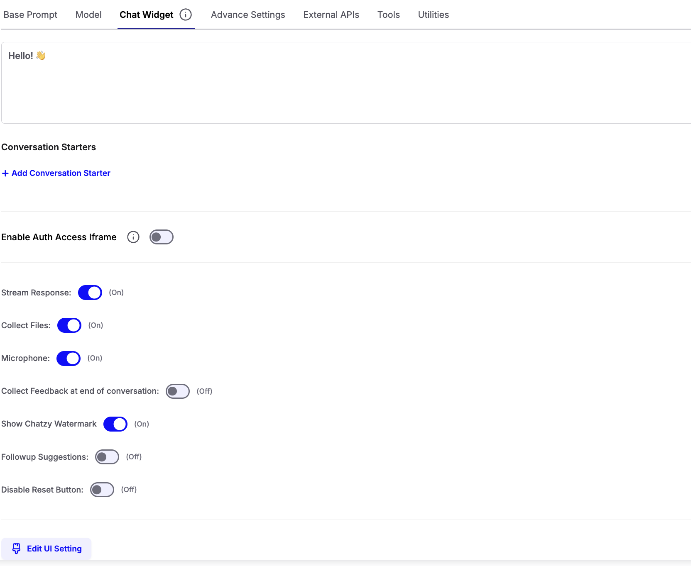
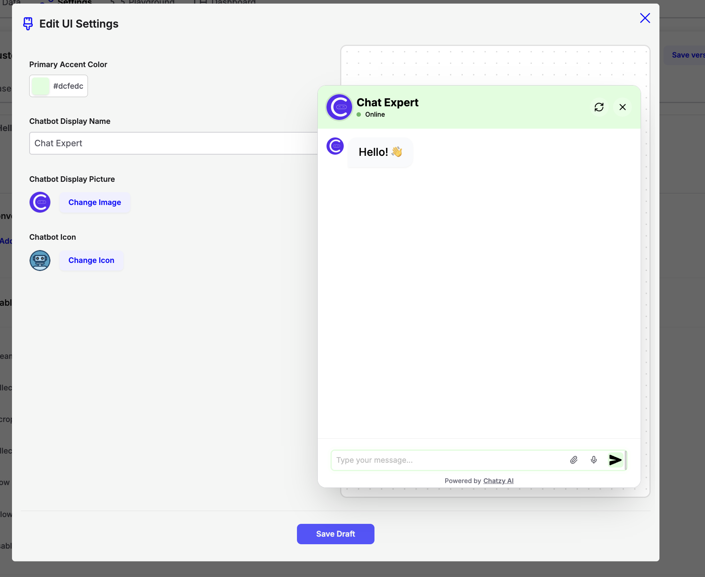

The **Chat Widget** tab lets you configure both the **behavior** and **appearance** of your chatbot widget before embedding it on your website. From greetings and conversation starters to branding and widget controls, this section allows you to tailor the chat experience to match your business.

<Frame>
  
</Frame>

---

## Conversation Experience

### Introductory Message

The **Introductory Message** is the first message displayed when a user opens the chat widget. Use it to welcome visitors, introduce your AI agent, or explain how it can help.

---

### Conversation Starters

Conversation Starters are predefined prompts that users can click to begin a conversation instantly.

They help reduce friction by guiding users toward common questions or actions.

Examples:

- "Tell me about your pricing."
- "Book a demo."
- "Talk to support."
- "Show available plans."

---

## Authentication

### Authenticated Iframe Access

Restrict your AI agent's iframe to visitors your own server has signed in. When it is on, the iframe only answers requests that carry a valid `access_token`, which your server gets from Chatzy with your **AI Agent Auth Key**.

This setting is hidden by default. To show it, open the agent's settings with `iframe_auth=1` in the URL:

```text
https://app.chatzy.ai/conversational-ai-agents/settings/<AGENT_ID>?tab=widget-settings&iframe_auth=1
```

The **Authenticated Iframe Access** section then appears on the **Chat Widget** tab, collapsed. Click it to expand. An agent that already has it on always shows the section, so you can turn it off without the URL flag.

1. Turn on **Enable Auth Access Iframe**.
2. Click **Generate Auth Key** and copy the key. It is shown **only once**, and the same key works for all your AI agents. **Regenerate** revokes the old key at once.
3. Pick the **Access Token Expiry** (15 minutes to 7 days, default 15 minutes) and **Refresh Token Expiry** (7 to 90 days, default 7 days).
4. Click **Save**.

<Warning>
Once it is on and saved, the plain widget embed and public iframe links stop answering for this agent. Roll out your token flow before you save.
</Warning>

Then follow [Get Access Token](/api-reference/authorized-iframe-access/get-access-token) to mint tokens on your server and embed the iframe, and [Refresh Token](/api-reference/authorized-iframe-access/get-new-access-token-from-refresh-token) to keep sessions alive.

---

## Widget Features

The following options allow you to enable or disable individual widget capabilities.

| Setting | Description |
|----------|-------------|
| **Stream Response** | Displays AI responses progressively as they are generated, creating a natural typing effect. |
| **Collect Files** | Allows users to upload files directly during the conversation. |
| **Microphone** | Enables voice input so users can speak instead of typing. |
| **Collect Feedback at End of Conversation** | Prompts users to rate or provide feedback after the conversation ends. |
| **Show Chatzy Watermark** | Displays the **"Powered by Chatzy AI"** watermark at the bottom of the chat widget. Available to disable only on the **Growth** plan and above. |
| **Follow-up Suggestions** | Displays suggested follow-up questions or actions after each AI response to encourage continued engagement. |
| **Disable Reset Button** | Removes the reset conversation button, preventing users from clearing the current chat session. |

---

## Widget Appearance

Click **Edit UI Setting** to customize your chatbot's appearance.

<Frame>
  
</Frame>

You can customize the following:

### Primary Accent Color

Choose the primary color used throughout the widget, including headers, buttons, highlights, and interactive elements.

---

### Chatbot Display Name

Specify the name displayed at the top of the chat window.

Example:

`Chat Expert`

---

### Chatbot Display Picture

Upload the avatar displayed beside the chatbot's messages throughout the conversation.

---

### Chatbot Icon

Upload the floating launcher icon shown on your website before the widget is opened.

---

## Live Preview

The right side of the **Edit UI Settings** window displays a live preview of your chatbot.

As you modify colors, names, images, or icons, the preview updates immediately, allowing you to verify your branding before saving.

Click **Save Draft** to save your widget customization.