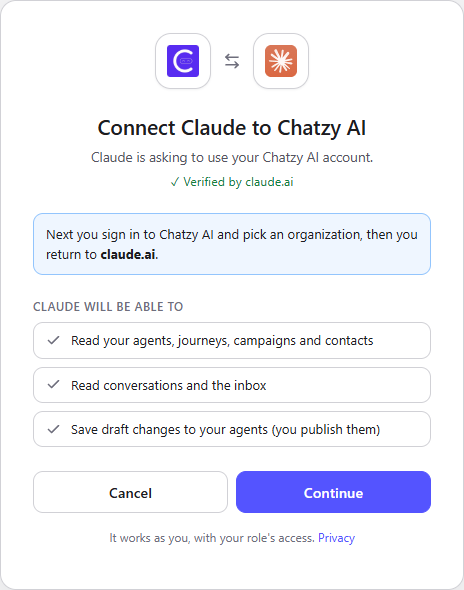
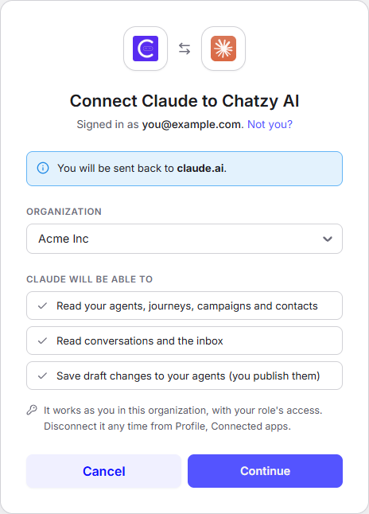
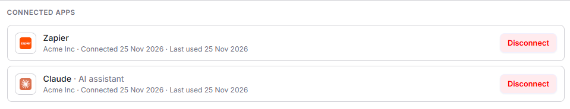

Chatzy AI has a remote MCP server, so an AI assistant like Claude can work with your Chatzy AI account in plain language: "Which agent handled the most chats this week?", "Summarize yesterday's unanswered WhatsApp conversations", "Make my sales agent's greeting shorter".

The assistant signs in as you, sees only the organization you pick, and has your role's access there. It never sees your password.

**Server URL**

```
https://mcp.chatzy.ai/mcp
```

## What the assistant can do

| Area | What it can read or do |
| --- | --- |
| **Account** | Your profile, plan, connected integrations and webhooks. |
| **AI agents** | List your agents, read their settings, versions, knowledge sources and training settings, and search an agent's knowledge base. |
| **Conversations** | The inbox, an agent's conversations, the messages in a conversation, contacts and their messages, and tags. |
| **Journeys** | Your journeys, their structure and versions, and recent runs. |
| **Campaigns** | Your campaigns and their delivery stats. |
| **Changes** | Edit an agent's settings. Changes are saved as a **draft**: nothing goes live until you publish the version in Chatzy AI. |

Settings your plan doesn't include are not offered to the assistant.

## Connect Claude

1. In Claude, open **Settings → Connectors** and click **Add custom connector**.
2. Name it **Chatzy AI**, paste the server URL `https://mcp.chatzy.ai/mcp`, and click **Add**.
3. Click **Connect**. A Chatzy AI window opens showing what Claude is asking for. Click **Continue**.

<Frame>
  
</Frame>

4. Log in to Chatzy AI if you are asked to (Google sign-in works too).
5. If you belong to more than one organization, choose the one Claude should use under **Organization**, then click **Continue**.

<Frame>
  
</Frame>

You are sent back to Claude and the connector is ready. Try asking: *"List my Chatzy AI agents."*

Other AI apps that support remote MCP servers with OAuth sign-in connect the same way: add `https://mcp.chatzy.ai/mcp` as a server and follow the same sign-in.

## Manage or disconnect

Every connected app is listed in Chatzy AI under **Profile → Connected apps**, with its organization, when it was connected and when it was last used.

<Frame>
  
</Frame>

Click **Disconnect** to cut access. The assistant stops working within a minute and asks you to connect again. Removing the connector in Claude alone does not revoke its access in Chatzy AI.

To use another organization, disconnect and connect again, choosing the other organization.

## Good to know

- The assistant acts as you. A member whose role can't see something in Chatzy AI can't see it through the assistant either.
- Agent changes are drafts. Review and publish them yourself in the agent's studio.
- A connection stays signed in for 30 days from when you connect it. After that, the app asks you to connect again.

## Troubleshooting

| What you see | What to do |
| --- | --- |
| "This app was disconnected from Chatzy AI" | The connection was disconnected in Profile. Connect again from the app. |
| "Sign in again to reconnect Chatzy AI" | The sign-in expired. Remove the connector in the app and add it again. |
| The assistant can't find an agent or conversation | It only sees the organization you picked. Check the organization in Profile → Connected apps. |
