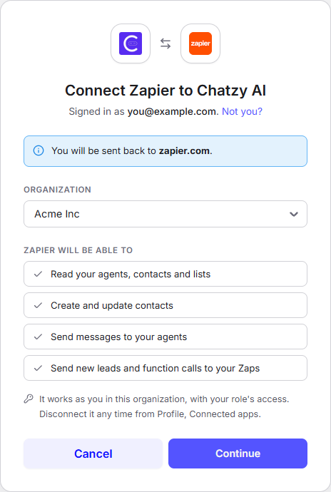
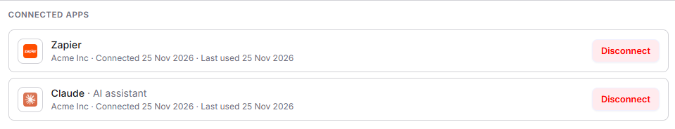

The Chatzy AI app for Zapier links your AI agents and contacts to thousands of other apps, with no code.

## What you can do

**Triggers** (start a Zap)

| Trigger | Fires when |
| --- | --- |
| **New Lead Captured** | An AI agent captures a lead it can contact: an email or phone number, with the name if given. Fires again if the lead adds another detail. Instant. |
| **New Function Call** | An AI agent calls a function or one of your API tools, with its result. Instant. |
| **New Contact** | A contact is added to Chatzy AI from any channel or import. |

**Actions** (do something in Chatzy AI)

| Action | What it does |
| --- | --- |
| **Create or Update Contact** | Adds a contact, or updates the one with the same email, phone number or LinkedIn URL. Tags and attributes are added, never removed. Can add the contact to a list. |
| **Send Message to AI Agent** | Sends a message to one of your agents and returns its reply. Map a Conversation ID to continue an earlier conversation. |

**Searches**

| Search | What it does |
| --- | --- |
| **Find Contact** | Finds a contact by email or phone number. **Find or Create Contact** creates it when none matches. |

## Before you start

- The Zapier integration is included in the **Starter plan and above**.
- Any member of an organization can connect it. The connection acts as that person, with their role's access: for example, a member who can't see agents can't subscribe a Zap to an agent's leads.

## Connect Chatzy AI to Zapier

1. In Zapier, create a Zap and search for **Chatzy AI** in any step.
2. Pick a trigger or action and click **Sign in**.
3. A Chatzy AI window opens. Log in if you are asked to (Google sign-in works too).
4. If you belong to more than one organization, choose the one to connect under **Organization**.
5. Review what Zapier will be able to do and click **Continue**.

<Frame>
  
</Frame>

The window closes and the connection appears in Zapier as *Organization name (your email)*.

## Manage or disconnect

Every Zapier connection is listed in Chatzy AI under **Profile → Connected apps**, with its organization, when it was connected and when it was last used.

<Frame>
  
</Frame>

To disconnect, click **Disconnect**. Zaps using it stop within a minute, their Chatzy AI triggers stop sending data to Zapier, and Zapier asks you to reconnect. Disconnecting in Chatzy AI is the only way to cut access; removing the connection in Zapier alone leaves it active.

A connection stays signed in for a year from when you connect it. After that, Zapier emails you to reconnect.

## Examples

- **New Lead Captured → HubSpot / Salesforce / Google Sheets**: every lead your website or WhatsApp agent captures lands in your CRM in seconds.
- **Typeform / Facebook Lead Ads → Create or Update Contact**: new form leads become Chatzy AI contacts, tagged and added to a list, ready for a WhatsApp campaign or journey.
- **Gmail / Help desk ticket → Send Message to AI Agent → Reply**: draft first replies with the agent trained on your knowledge base.
- **New Function Call (`book_demo`) → Google Calendar / Slack**: act on a booking the moment the agent makes it.

## Notes

- **New Lead Captured** and **New Function Call** are instant: Chatzy AI sends each event to Zapier as it happens. When you test the trigger, Zapier shows up to 3 recent events from the last 30 days, or a sample if there are none yet.
- **New Contact** is checked by Zapier every few minutes, depending on your Zapier plan.
- **Send Message to AI Agent** uses your Chat Credits like any other conversation and shows up in the agent's Chat Logs. Agents that only accept signed-in website visitors cannot be messaged from Zapier.
- Phone numbers are matched on digits only, so `+91 98765 43210` and `919876543210` find the same contact.

## Troubleshooting

| Message in Zapier | What to do |
| --- | --- |
| Your plan doesn't include the Zapier integration. | Upgrade to Starter or above. |
| You don't have permission to perform this action. | Your role in the organization doesn't allow this step (for example, reading agents). Ask an admin to change your role, or to connect Zapier themselves. |
| Your Chatzy AI connection is no longer valid. | The connection was disconnected in Chatzy AI, or its year has run out. Reconnect Chatzy AI in Zapier. |
| The agent did not reply. | Open the agent's Chat Logs in Chatzy AI to see why (for example, Chat Credits ran out). |
